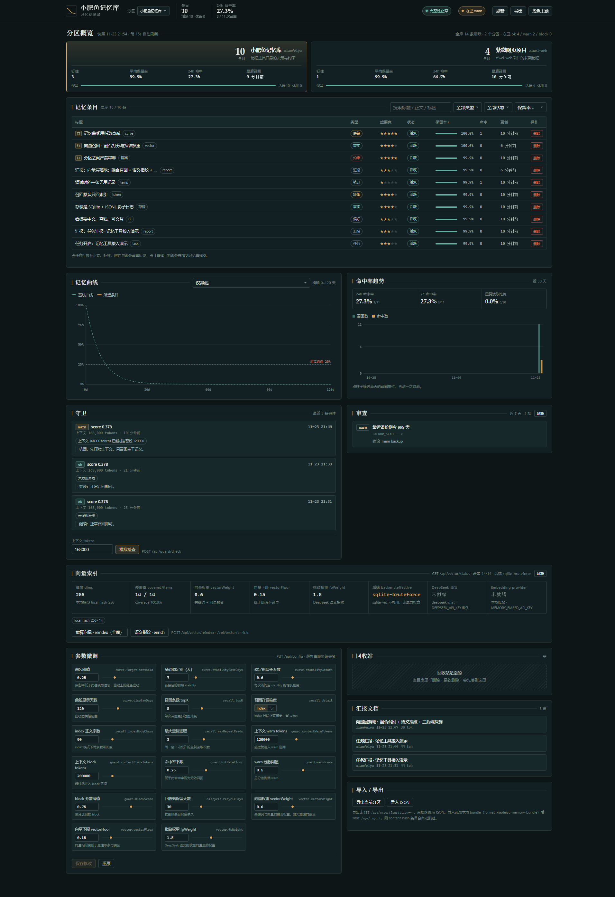
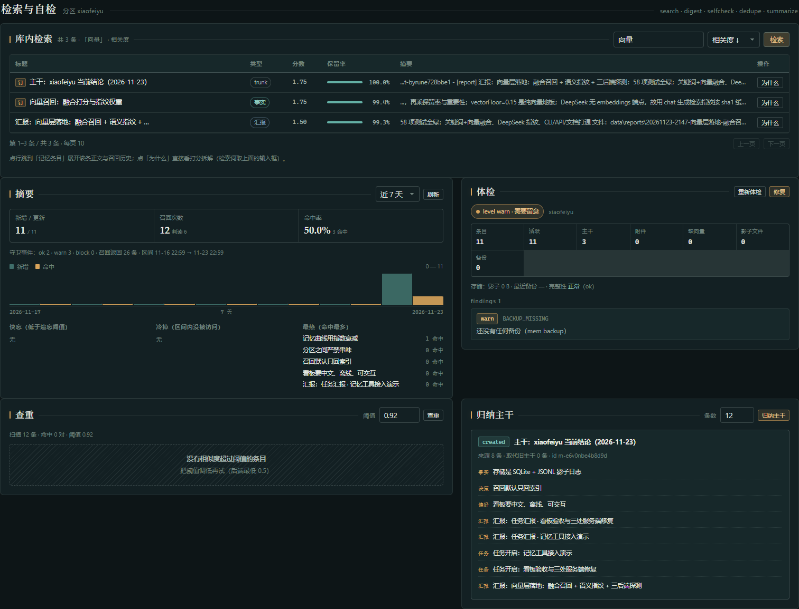

# Xiaofeiyu Memory · dsh-xiaofeiyu-memory

[中文](README.md) | **English**

> Long-term memory for an AI that forgets, isolates by topic, and audits itself.

This is a **DeepSeek Harness (DSH) plugin** and also a standalone local memory store.
The two things that break multi-turn, long-running conversations most often — *remembering what should stay
separate* and *forgetting what should never have been kept* — are both handled deliberately here.

> A note from the author: this plugin was written by a **student with no AI background** who was playing
> around with DeepSeek Harness. It really works (187 automated tests pass), but the design has plenty of room
> to grow. Feedback is welcome. 🙏

---

## What it solves

| The usual long-conversation failure | What this does |
| --- | --- |
| Memories from different projects bleed into each other | **Partition isolation** — one topic, one partition. `recall` requires a partition and cross-partition access is rejected in code |
| Store everything, get slower and messier | **Forgetting curve** — `retention = exp(-Δt / stability)`; used memories become durable, unused ones decay, low-retention items go dormant/archived, the trunk never sleeps |
| Context too long → re-reading the same things → hit rate drops → hallucination | **Guard + audit** — scores context pressure / hit rate / redundant reads / stale share, returns `warn` or `block` with a "answer from the trunk only" directive |
| The guard gives advice but you don't know how to act on it | **One-click fix** — a panel card or `mem fix` produces a 5-step plan (each step with an impact count and a preview); nothing runs without `confirm` |
| Details are remembered in too much depth and the main thread gets lost | **Three layers** — ★ trunk / · scene / detail; `task end` folds conclusions into the trunk and records a scene; a new session gets a compact trunk digest in its first turn |
| You cannot find that one conclusion again | **Two-stage recall + token budget** — `index` returns only the first 90 chars; `recall` has a hard 1200-token budget, downgrading then dropping items and telling you how many |
| You have no idea whether memory actually helps | **Live dashboard** — hit-rate trend, per-item memory curve, per-partition boards; interactive charts, import/export, tunable parameters |
| A corrupted store loses everything | **Layered safety** — SQLite primary + JSONL shadow log (rebuildable) + scheduled backups + integrity checks + recycle bin + restorable reports |
| Arbitrary notes outlast the important conclusions | **FSRS-style adaptivity + trunk reinforcement** — hits lower difficulty and stretch intervals, misses discount; the trunk has a retention floor (0.55) and `reinforce` can boost it |

## Core mechanisms in one line each

1. **Partition** — the root scope of all data. `remember / recall / search / audit` all require one, and
   `item_link` refuses cross-partition edges. **Read paths are strict**: a typo raises `unknown partition`
   instead of silently creating an empty partition; only write paths (`remember`, `task start`, `import`)
   create partitions on demand.
2. **Forgetting curve** — every item carries a `stability` (in days).
   - Recalled with `used: true` → `stability *= (1 + growth)`.
   - Recalled with `used: false` → decays faster.
   - `retention < forgetThreshold` → `dormant`; `< archiveThreshold` → `archived`.
   - `pinned` or `importance >= trunkImportance` never sleeps — that is the "keep the trunk" rule.
3. **Guard** — `score = 0.45*pressure + 0.25*(1-hitRate) + 0.2*redundancy + 0.1*staleShare`, plus **hard
   thresholds**: crossing `contextWarnTokens` warns, crossing `contextBlockTokens` blocks (no reliance on
   weighted scores).

On top of that sits a **closed loop**: `task start` hands over the trunk → `recall/feedback/guard` while
working → `task end` consolidates (trunk + scene memory) and sweeps dormant items → `mem daily` writes a
health digest, `mem eval` measures retrieval quality, `mem site` exports a static site. In plugin form,
`agent/pre-step` and `agent/turn-stopping` run the guard for you (automatic write-side sweeping is off by default).

## What v0.2 added

- **Three layers** — no schema change: `layer` is derived from `kind` + `pinned` + `importance`
  (trunk / scene / detail), so existing stores need no migration. `mem trunk --digest` returns a compact
  trunk; the `xfy_memory_trunk` tool exposes the same thing.
- **Token budget** — `recall` accepts `budget` (default `recall.budgetTokens = 1200`); on overflow it
  downgrades `full → index`, then drops trailing items, reporting `totalTokens / budgetDropped /
  budgetDowngraded / layers`.
- **One-click guard fix** — `planFix` proposes steps (sweep dormant items / build a trunk draft / back up
  now / clean statistics windows / merge near-duplicates) and `applyFix` refuses unless called with
  `confirm: true`. The panel renders it as a checklist; the CLI exposes `mem fix` (preview) and
  `mem fix --apply`.
- **First-turn trunk injection** — an `agent/pre-step` middleware appends one
  `source.kind = 'xiaofeiyu-memory'` message to `decision.messages` when `turn === 1 && step === 1`
  (~100 tokens); later turns get nothing. Toggle: `injectTrunk`.
- **Scaffolding is not knowledge** — the "task started" item written by `task start` is excluded from recall
  candidates, trunk archiving and merge candidates (still findable with `search`).

## Install

### As a DSH plugin

```bash
# From the market (once published):
dsh plugin --profile web add dsh-xiaofeiyu-memory

# Local development:
dsh plugin --profile web add link:/path/to/xiaofeiyu-memory
```

You get **14 native tools** (`xfy_memory_*`); data lives in `~/.dsh/xiaofeiyu-memory/data` by default and can be
moved with the plugin's `root` config or the `XFY_MEMORY_ROOT` environment variable.

When the host provides `webServer`, the plugin also mounts `/xfy-memory` (HTTP API + static dashboard) and
registers `lib/client.js` as a **native React panel** in the right sidebar plus a session-header button — no
extra server needed. See [docs/DSH-PLUGIN.md](docs/DSH-PLUGIN.md) for both halves.

### As a standalone CLI / server (no plugin required)

```bash
git clone https://github.com/PeterHuazai/dsh-xiaofeiyu-memory.git
cd dsh-xiaofeiyu-memory
npm install          # only sqlite-vec, an optional dependency
node src/server.mjs  # dashboard: http://127.0.0.1:8787/

node src/cli.mjs partition add --name myproject --title "My project"
node src/cli.mjs task start --partition myproject --title "What I am doing today"
node src/cli.mjs recall --partition myproject "keyword" --detail index --budget 1200
node src/cli.mjs remember --partition myproject --title "Conclusion" --body "Evidence and boundaries" --importance 4
node src/cli.mjs trunk --partition myproject --digest --max-tokens 200
node src/cli.mjs fix --partition myproject            # preview only
node src/cli.mjs fix --partition myproject --apply --step backup
node src/cli.mjs task end <taskId> --summary "One-line result" --md "## Done
## Conclusion
## Left over"
```

## The 14 plugin tools

| Tool | What it does |
| --- | --- |
| `xfy_memory_recall` | Recall the few most relevant items in a partition (lexical + vector + decay + importance); returns `eventId`; accepts a `budget` |
| `xfy_memory_remember` | Write a durable conclusion (deduplicated by content hash); `kind` supports `trunk` / `scene` |
| `xfy_memory_search` | Full-text sweep with paging and sorting, returning snippets |
| `xfy_memory_feedback` | Report whether a recall was actually used — the only signal behind hit rate and the forgetting curve |
| `xfy_memory_guard` | Four-factor score → `ok`/`warn`/`block` with a directive; `plan: true` returns a fix plan, `apply: true` + `confirm: true` executes it |
| `xfy_memory_trunk` | Compact trunk digest (cheaper than `recall`), truncated to a token budget with layer counts |
| `xfy_memory_audit` | Health report (stale items, bloat, low hit rate, missing trunk, task leaks, stale backups…) |
| `xfy_memory_digest` | What was learned, what was used, what is cooling down (with daily buckets) |
| `xfy_memory_health` | Structural check with optional safe repairs (backfill vectors, drop dangling links) |
| `xfy_memory_dedupe` | Find near-duplicates; suggestions only, never auto-merge |
| `xfy_memory_summarize` | Collapse scattered memories into a pinned trunk; the old trunk is superseded, not deleted |
| `xfy_memory_link` | Link items (conclusion ↔ evidence) with a same-partition constraint |
| `xfy_memory_explain` | Explain why an item was recalled or is fading (score broken down term by term) |
| `xfy_memory_task` | Task gate: `start` opens a task and returns the trunk; `end` requires a report and consolidates |

## Dashboard



Run `node src/server.mjs` and open <http://127.0.0.1:8787/> — a single file, no outbound requests, fully offline:

- Partition overview, item table with a **layer** column (★ trunk / · scene / detail), **memory curves**
  (hover a day, click the legend to hide a series)
- **Hit-rate trend** (click a bar to filter that day), guard events, audit findings, **one-click fix card**
  (plan → check → execute)
- Recycle bin, 25+ tunable parameters (applied immediately), import/export, report documents
  (delete / restore / purge)
- Vector index panel (backend, coverage, semantic fingerprints), multimodal caption panel
- **Search & self-check** panel (search / digest / health / dedupe / summarize); click "why" on an item to see
  its score breakdown


- The search & self-check panel (graphical entry points for search / digest / health / dedupe / summarize / explain)

## Repository layout

```
index.js            plugin host half (14 tools + /xfy-memory routes + pre-step middleware + first-turn injection)
lib/hostdeps.mjs    pulls schemastery / defineTool from the host tree, falls back to local equivalents
lib/client.js       plugin client half: native DSH right-sidebar React panel (wrapped in __ModuleLoader__)
cordis.patch.yml    plugin mount point
src/db.mjs          SQLite schema + shadow log + backups + config
src/engine.mjs      tokenizer, forgetting curve, remember/recall/feedback, layers, trunk digest, consolidate, attachments
src/vector.mjs      local hash vectors + semantic fingerprints + backend probing + ANN
src/guard.mjs       guard scoring and audit, one-click fix (planFix / applyFix)
src/harness.mjs     DSH session scanning and import (multi-frame zstd, one project → one partition)
src/tasks.mjs       task gate, report lifecycle, import/export, config clamping
src/vision.mjs      multimodal captions (optional vision model)
src/tools.mjs       search/digest/explain/link/expand/pin/health/dedupe/summarize
src/server.mjs      HTTP API + static dashboard
src/cli.mjs         command line
web/index.html      dashboard (single inlined file)
docs/DSH-PLUGIN.md  plugin halves, slots, waterfall contract, install and verification
tests/run-tests.mjs 187 assertions
```

## Configuration (all editable in the dashboard; `updateConfig` clamps to sane ranges)

| Key | Default | Meaning |
| --- | --- | --- |
| `curve.stabilityBaseDays` | 7 | Initial stability of a new memory (days) |
| `curve.forgetThreshold` | 0.25 | Below this → dormant |
| `curve.archiveThreshold` | 0.02 | Below this → archived |
| `curve.trunkImportance` | 4 | Importance at or above this never sleeps |
| `recall.topK` / `minScore` | 8 / 0.12 | Result count and score floor |
| `recall.detail` / `indexBodyChars` | index / 90 | Return only the first 90 chars by default (token saving) |
| `recall.budgetTokens` | 1200 | Hard token budget per recall |
| `guard.contextWarnTokens` / `contextBlockTokens` | 120000 / 200000 | Hard thresholds |
| `vector.vectorWeight` / `vectorFloor` / `fpWeight` | 0.6 / 0.15 / 1.5 | Vector fusion and fingerprint weights |
| `curve.adaptive` | true | FSRS-style review: hits lower difficulty and stretch intervals, misses multiply by 0.45 |
| `curve.trunkFloor` / `trunkBoostGrowth` / `trunkBoostMax` | 0.55 / 1.35 / 4 | Trunk retention floor and reinforcement cap |
| `maintain.cleanupDays` / `mergeThreshold` / `digestTokens` | 30 / 0.6 / 320 | Fix-step cleanup window, merge threshold, digest budget |
| `injectTrunk` (plugin config) | true | Inject the trunk digest in the first turn of a new session |
| `lifecycle.recycleDays` | 30 | Recycle-bin retention (days) |

## Known limits (no marketing)

- **The official DeepSeek API has no embeddings endpoint** (only chat/completions and FIM), so vectors are
  "local hash + DeepSeek-generated semantic fingerprints". Point `vector.provider` at any OpenAI-compatible
  `/v1/embeddings` for real embeddings.
- `sqlite-vec` / `qdrant` are **probe slots**: if the sqlite-vec extension is installed it is used for ANN,
  otherwise the plugin falls back to brute-force vector scans (fine well into the thousands of items).
- Multimodal captions are off by default (`multimodal.vision.enabled=false`); supply an OpenAI-compatible
  vision endpoint yourself. Without one, images simply have no captions and cannot be recalled.
- The dashboard assumes a single local user with no authentication — do not expose it to the internet.

## Tests

```bash
node tests/run-tests.mjs             # 187 passed / 0 failed
node tests/plugin-smoke.mjs          # plugin smoke: 14 tools register, fix plan, first-turn injection (26 PASS)
node tests/client-panel.test.mjs     # panel rendering and request URLs (107 assertions)
node tests/cordis-waterfall.test.mjs # waterfall contract against the real cordis library (5 assertions)
```

Coverage includes partition isolation and strict partitions, deduplication, index vs full recall, token-budget
dropping and downgrading, forgetting curve and feedback, guard hard thresholds, fix planning and confirmation,
layer derivation and trunk digest, idempotent consolidate, report lifecycle, import/export, shadow-log rebuild,
attachments and captions, lazy vector backfill, semantic fingerprints, HTTP integration, CLI regression,
boundary cases for the eight utility tools (cross-partition rejection, dangling-link repair…), adaptive curve
(trunk floor vs plain exponential, FSRS review, trunk reinforcement, forecasts that respect the floor),
near-duplicate merging, trunk archiving on task end, retrieval evaluation, health digests and static-site export.

## License

MIT
